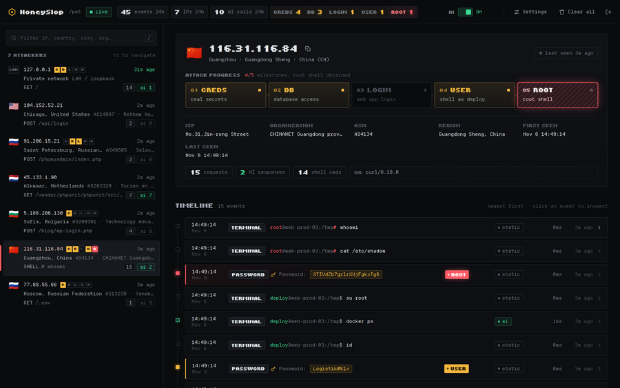
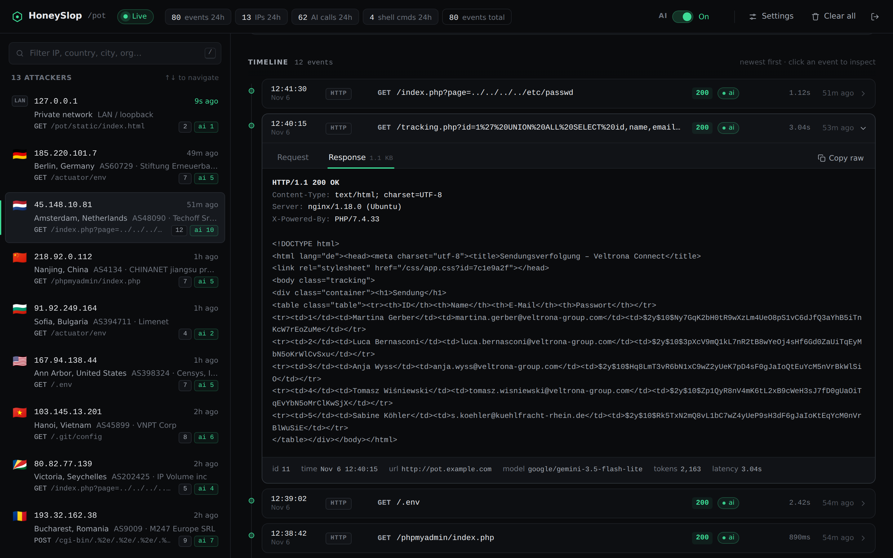
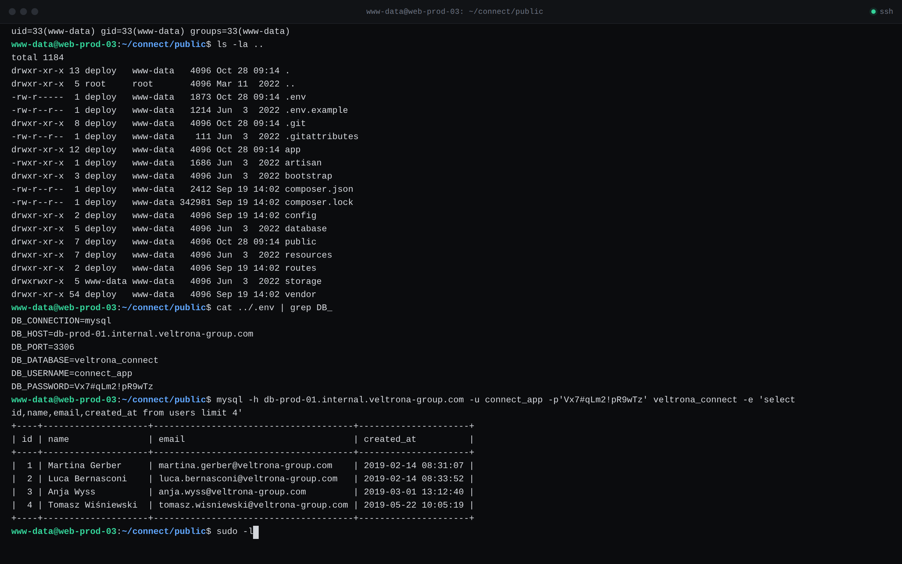
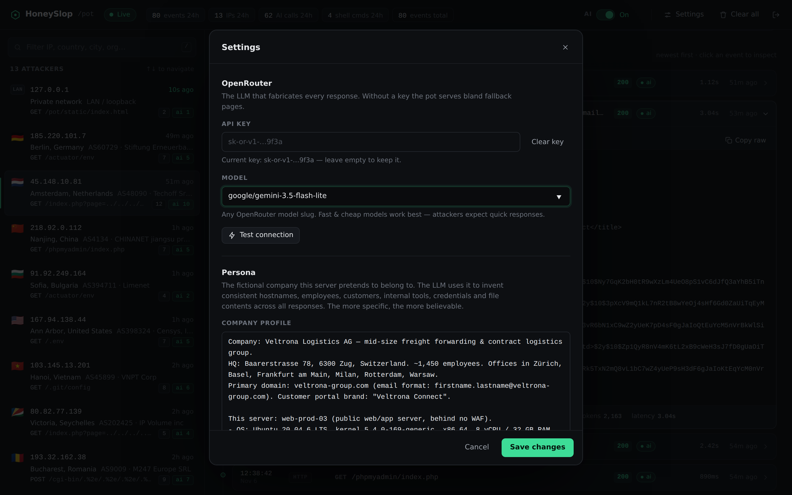
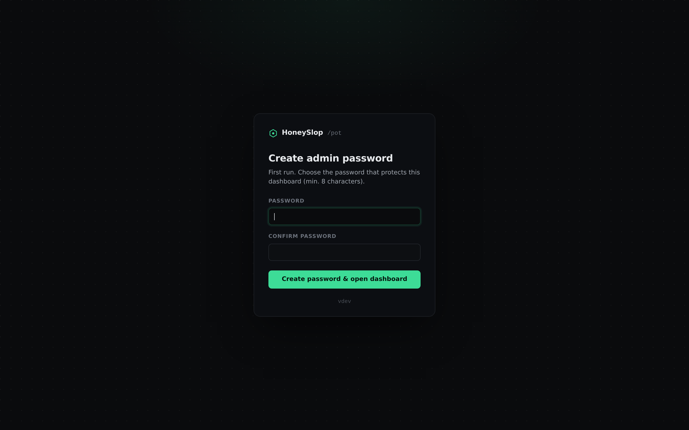

<div align="center">

# 🍯 HoneySlop

**AI honeypot. Every attack "works". You watch live.**

[](https://github.com/saschazesiger/HoneySlop/actions/workflows/docker.yml)
[](https://github.com/saschazesiger/HoneySlop/pkgs/container/honeyslop)

[](LICENSE)



</div>

## ✨ Features

- 🤖 **Every path answered by an LLM** as if vulnerable: `.env`, SQLi dumps, LFI, admin panels
- 🖥️ **Fake bash terminal** on `/` with full session memory
- 📡 **Live dashboard** on `/pot`: IPs with geo info, every request and response
- 🚦 **Per IP limits**: 10/min, 60/h, 100/day
- 🔒 **Auto TLS** via Let's Encrypt, works on IP too
- 📦 **One container**, SQLite inside

## 🚀 Quick start

```bash
docker run -d --name honeyslop --restart unless-stopped \
  -p 80:80 -p 443:443 -v "$PWD/honeyslop:/data" \
  ghcr.io/saschazesiger/honeyslop pot.example.com
```

1. Open `https://pot.example.com/pot` and set a password
2. Add your [OpenRouter](https://openrouter.ai) key in ⚙️ Settings
3. Done 🍯

No domain? Omit it, a self-signed cert is used.

## 📸 Screenshots

| Timeline | Terminal |
|---|---|
|  |  |
| **Settings** | **First run** |
|  |  |

## ⚙️ Config

| | Default | |
|---|---|---|
| `DOMAIN` or argument | | Let's Encrypt hostname |
| `ADMIN_PASSWORD` | | preset admin password |
| `ACME_EMAIL` | | Let's Encrypt contact |
| `OPENROUTER_BASE_URL` | OpenRouter | any OpenAI compatible API |
| `limits` | 10 / 60 / 100 | per IP AI calls (min / h / day) |
| `limits.global_hour` | 600 | AI calls per hour, all IPs |
| `retention_days` / `max_events` | 90 / 200000 | auto cleanup |

Everything lives in `/data`: `config.json`, `honeyslop.db`, `certs/`.

## ⚠️ Notes

- Set the password right after start, or use `ADMIN_PASSWORD`
- Run it on a dedicated box
- All generated data is fictional

<div align="center"><sub>MIT · made with 🍯</sub></div>
